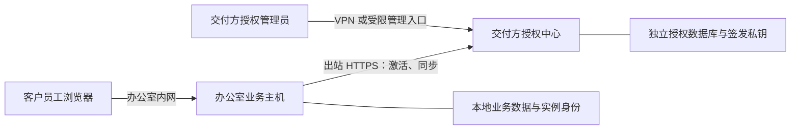

# 实例授权锁定与授权管理平台开发方案

> 状态：开发实施与验收记录；下面保留设计约束，并按实际验证证据更新验收清单。
>
> 场景：业务平台部署在客户办公室主机，主机允许联网；客户使用企业管理员账号。授权中心部署在交付方控制的服务器上，可使用固定公网 IP，不强制要求域名。
>
> 实施位置：独立工作区 `AIPlatform-instance-licensing`，分支 `feature/instance-licensing`。部署、授权与恢复命令见 [操作文档](instance-license-operations.md)。当前运行实例及真实业务数据不用于测试。

## 1. 目标与边界

采用「办公室本地业务平台 + 独立在线授权中心 + 短期签名凭证」。授权绑定整套部署实例，实例到期后所有企业、账号及业务入口统一锁定，企业管理员没有授权豁免。现有用户、组织和功能权限继续生效，不被授权系统替代。

业务执行必须同时满足：实例授权有效、用户身份有效、用户具有相应业务权限。

必须实现：

- 开通试用、一次性激活、延期、撤销、恢复授权、主机迁移重绑。
- 在已知截止时间自动锁定，不依赖某次定时任务恰好执行成功。
- 锁定后拒绝业务读写和新任务，停止应用可控制的在途任务，保留客户数据。
- 锁定期间继续联网检查授权；收到有效新授权后恢复入口，无需重装或改数据库。
- 客户管理员只能查看状态和触发同步；授权签发及管理权限仅属于交付方。

不承诺：抵御拥有主机 root、Docker 管理权或物理磁盘访问权的人修改程序；撤回已经发送给外部服务的邮件或请求；收回已经下载的文件和浏览器缓存。在线授权限制正常应用使用，不等于不可破解的 DRM。

本方案不包含支付、订阅计费、模型网关、复杂硬件指纹、代码混淆、离线应急授权和万能密码。模型网关可以独立建设，但不是本方案停用业务的唯一门禁。交付继续保留现有开源许可证和第三方声明，商业试用条款不能替代开源许可。

## 2. 部署架构与信任边界

### 2.1 办公室业务主机

- 使用固定内网地址或 DHCP 保留地址，员工通过内网访问。
- 不需要固定公网 IP，不需要为了授权做公网端口映射。
- 必须能出站访问授权中心 HTTPS；服务器不主动连接客户办公室。
- 保存业务数据、实例私钥及授权缓存，不保存授权中心签发私钥。
- 应用服务保持运行，锁定时进入受限模式，不关闭整台主机。

### 2.2 授权中心

- 交付方独立掌握服务器、管理员账号、数据库和签发密钥。
- 与客户业务平台使用不同进程、数据库、认证会话和发布包，不在客户安装包中提供签发服务。
- 主机接口公开必要的 HTTPS 服务；管理页面和管理 API 优先通过 VPN，仅允许交付方访问。
- 授权中心只保存客户与授权元数据，不接收客户文档、会话内容或模型供应商密钥。业务模型调用是否出网由现有模型配置决定。
- 一台客户主机只登记一套实例；同实例存在多个企业时，全部共享实例授权状态，不支持只停用其中一个企业。

## 3. 第一版确定的策略

| 项目 | 初始策略 | 约束 |
| --- | --- | --- |
| 普通同步 | 每小时一次，启动时立即同步 | 不按每个业务请求访问授权中心 |
| 锁定后的同步 | 每 5 分钟尝试一次 | 保证续期后仍能自动恢复 |
| 缓存凭证 | 最长 24 小时 | 不超过授权真正截止时间 |
| 单次联网 | 总超时 10 秒 | 失败不阻塞应用启动和业务事件循环 |
| 手动同步 | 企业管理员可触发，实例级限频 | 同一实例请求合并，避免并发刷新风暴 |
| 截止时间 | UTC 时间点，比较使用 `now >= deadline` | 管理页面明确时区，不把“当天截止”默认为当天零点 |
| 默认状态 | 未激活或无有效凭证时锁定 | 不提供客户可操作的关闭授权检查开关 |

这些是实施默认值，不是当前实测性能。后台周期失败采用有界退避和少量随机抖动，不能突破凭证截止时间。缓存容错不是试用到期后的额外宽限。

提前撤销时，正常联网实例下一次同步生效；断网实例最迟在已有缓存到期时锁定。不能把最长 24 小时缓存描述为“撤销立即生效”。需要更快撤销时，由交付方缩短同步周期和签发凭证期限。

## 4. 授权管理平台

### 4.1 页面与权限

独立 React 管理界面，沿用项目的 TypeScript、API 封装和中英文 i18n 组织方式，不复用客户业务后台的登录 Token。

| 页面 | 主要能力 |
| --- | --- |
| 登录与账户安全 | 密码登录、TOTP 二次验证、退出、会话管理 |
| 概览 | 有效、即将到期、已到期、撤销实例数量；最近联系时间 |
| 客户管理 | 创建、编辑、停用客户；联系人、备注和实例列表 |
| 实例详情 | 实例编号、公钥指纹、授权期限、撤销状态、版本、最近同步结果 |
| 激活码管理 | 生成、显示一次、作废；查看过期或已使用状态 |
| 授权操作 | 开通、延期、撤销、恢复、替换主机重绑 |
| 审计记录 | 操作者、目标、操作前后有效期及状态、原因、时间 |
| 系统运维 | 授权服务状态、证书和签名密钥轮换状态，不展示私钥 |

第一版角色：所有者可管理操作员与密钥轮换；授权操作员可管理客户及授权；只读人员只可查询。每个 API 在服务端校验权限，不能仅隐藏按钮。

管理员由服务器运维命令初始化，不开放公网自注册。密码采用成熟密码哈希库；TOTP 使用成熟库，不自行设计算法。登录限频，管理会话采用安全 Cookie、明确过期和注销能力，写操作进行 CSRF 防护；敏感操作要求近期二次验证。

撤销、恢复、重绑均要求原因和二次确认；延期页面同时显示修改前后日期。客户或授权记录停用而非物理删除，保留审计。

### 4.2 日常操作流程

1. 开通：你新建客户，设置明确截止时间，生成短期激活码。截止时间不会因重装、改密码、换管理员或再次激活而重置。
2. 激活：交付前由你完成主机登记，或由客户管理员在激活页输入激活码。主机取得有效凭证后进入业务系统。
3. 延期：你修改截止时间并保存，提高授权版本；客户点击“重新检查授权”或等待自动同步。
4. 提前停止：你撤销实例，保存原因和新版本；主机获得可信撤销结果后锁定。
5. 恢复：被撤销的实例必须明确恢复；若期限已过，还需延期。仅延长日期不会隐式解除撤销。
6. 换机：你撤销旧实例并为新实例生成替换激活码，沿用客户原有截止时间。明确提示旧主机在断网缓存有效期内仍可能运行。

停用客户时，中心为关联授权递增版本，并在同步时返回可信停用结果；恢复客户不会取消某个实例原有的单独撤销标记。管理账户丢失由交付方在中心服务器上执行受审计的账户恢复、注销旧会话，不设置客户主机上的解锁后门。

日期修改、状态更新、授权版本递增和审计写入须在同一数据库事务中完成。采用乐观版本检查，避免两名操作员相互覆盖。

## 5. 数据与密钥设计

### 5.1 授权中心数据

第一版使用独立 SQLite WAL 数据库、单应用进程，后续容量不足再评估 PostgreSQL；不与客户控制数据库共用。

| 表 | 核心字段与规则 |
| --- | --- |
| `customers` | 公共客户 ID、名称、联系人、状态、备注、创建时间 |
| `instances` | 公共实例 ID、客户 ID、实例公钥、指纹、绑定状态、最后联系时间 |
| `licenses` | 公共授权 ID、实例 ID 唯一、截止时间、撤销标记、单调递增版本 |
| `activation_codes` | 码摘要、客户及授权关联、失效时间、使用时间、已绑定实例 |
| `instance_challenges` | 挑战摘要、操作、实例、短期失效时间、已消费状态 |
| `admin_users` / `admin_sessions` | 密码哈希、角色、受保护的 TOTP 秘密、会话失效信息 |
| `audit_log` | 操作者、对象、操作、前后值、原因、UTC 时间 |

资源表使用整数主键加公共字符串 ID；中心独立 schema 将整数主键命名为 `pk`、公开字符串命名为 `id`，外部 API 及子表外键只使用公共字符串，不引用整数主键。主平台现有 `id` / `{entity}_id` 命名与共享 SQLite/PostgreSQL schema 不变。中心管理员沿用整数身份键，必要唯一约束和索引由独立迁移维护；不记录原始激活码、私钥或完整认证请求。

激活码使用密码学安全随机数，只保存摘要；默认 24 小时内使用，管理员可提前作废。一次性表示只能绑定一个实例。并发兑换必须通过事务确保仅一个绑定成功；网络响应丢失后，同一实例和公钥可幂等恢复结果，其他实例不得重复兑换。

### 5.2 客户主机数据

新增系统级授权目录，独立于 Agent 工作区和客户可编辑的业务文件：

- 实例 ID 与 Ed25519 实例私钥，首次生成后保持稳定。
- 已验证的签名凭证、最高已接受授权版本、最近可信服务器时间、撤销栅栏和同步状态。
- 可信授权签名公钥集合，按 `kid` 区分。

目录由专用应用账户访问；私钥权限仅该账户可读，写入采用原子替换。不得通过工作区接口、配置导出、日志或普通备份下载暴露实例私钥。主机灾备可由交付方做受保护的身份备份，普通业务数据导入不能替换身份或清除撤销状态。

实例身份不是可靠硬件绑定：完整克隆磁盘可能复制同一身份。第一版可限制登记数量并展示异常联系信息，但不宣称可杜绝克隆，也不根据 IP 变化自动停用客户。

### 5.3 签名密钥和 TLS 密钥

授权凭证采用 Ed25519/JWS，固定算法白名单、协议类型、签发者和受众。可使用现有 `cryptography` 与 `PyJWT` 能力，但授权凭证与业务 JWT 使用不同密钥、验证入口和用途。

授权中心签发私钥存放在受限挂载文件或密钥管理服务中，独立于数据库；禁止进入 Git、镜像和客户交付包。TLS 证书私钥不是授权签发私钥，两者分别备份和轮换。

轮换先通过可信版本更新向客户端分发新验证公钥，再切换中心签发 `kid`，保留必要重叠期。客户端不能信任响应中随意附带的新公钥；紧急密钥泄露需要运维更新信任集合，不能只删除中心旧私钥就宣称全部客户端已安全。

## 6. 激活与同步协议

### 6.1 身份证明

主机生成实例密钥对。激活时提交实例 ID、公钥、激活码，并证明持有对应私钥。已登记实例同步时，先取得中心随机挑战，再用实例私钥签名证明。

挑战默认 60 秒有效、至少 256 位随机，绑定操作和实例，仅消费一次。证明绑定挑战、实例 ID、操作名、协议受众和请求内容摘要，不能把同步签名复用于激活或其他操作。激活及挑战接口限频；未知实例和激活码错误不泄露客户信息。

激活失败或响应丢失不能删除已生成的实例身份；重试使用同一实例 ID、公钥，通过幂等登记或已登记身份同步恢复，不重新起算试用时间。

### 6.2 签名响应

签名响应必须包含：协议版本、产品标识、签发者、实例受众、实例 ID、公钥指纹、请求挑战、授权 ID、授权版本、状态、签发时间、凭证到期时间、真实授权截止时间和签名 `kid`。

有效响应满足 `valid_until = min(issued_at + 凭证期限, license_expires_at)`。第一版整实例授权统一开放已有业务能力，用户能用哪些功能仍由现有权限控制，不另造一套功能角色系统。

允许业务的凭证使用上述期限公式；否定响应使用独立的短期响应有效期验证新鲜度，不能因其描述的真实授权截止时间已过去而丢弃撤销/到期结果。协议时间字段使用明确的 UTC Unix 秒整数，拒绝含糊本地时间和隐式类型转换。

到期或撤销也返回经过签名、绑定本次挑战的否定结果。收到更高版本可信否定结果，先持久化撤销栅栏，再锁定；旧缓存不能覆盖该结果。恢复必须收到中心明确签发的有效结果，版本不得低于已接受版本，同版本内容冲突必须拒绝。

TLS、签名、类型、受众、实例、公钥指纹、版本、挑战或期限验证失败的网络响应不成为授权依据。网络伪造或损坏响应只记同步失败，不覆盖仍有效的已验证缓存；本地缓存自身被篡改或验证失败则锁定。普通 HTTP 错误或超时不能被误解释为可信的撤销指令。

### 6.3 已实现 API 合同

| 位置 | 接口 | 权限与结果 |
| --- | --- | --- |
| 中心 | `POST /api/v1/instance/challenges` | 发放有界、一次性挑战，限频 |
| 中心 | `POST /api/v1/instance/activate` | 激活码及持钥证明，原子绑定并签发响应 |
| 中心 | `POST /api/v1/instance/sync` | 已登记实例持钥证明，返回签名状态 |
| 中心 | `/api/v1/admin/customers`、`instances`、`activation-codes` | 管理会话认证；各资源独立 CRUD 与权限 |
| 中心 | `POST /api/v1/admin/licenses/{id}/extend`、`revoke`、`restore` | 二次验证、原因、版本检查、审计 |
| 中心 | `POST /api/v1/admin/instances/{id}/replace` | 撤销旧实例并生成新绑定凭据，不重置原期限 |
| 主机 | `GET /api/license/status` | 公开最小锁定状态，不公开凭证、客户详情或私钥 |
| 主机 | `GET /api/license/details` | 已认证管理员查看实例编号、截止时间、同步结果 |
| 主机 | `POST /api/license/activate`、`refresh` | 已认证管理员或严格限定的首次安装身份，限频 |

管理登录、MFA、会话退出和审计查询另设中心管理接口。所有接口使用明确 Pydantic 模型、摘要和错误码；主机使用现有 Scalar，独立中心使用 FastAPI 自带的 Swagger/OpenAPI 文档。中心错误与签名业务状态分开，不使用 HTML 错误页作为协议。

主机业务门禁统一返回 HTTP 403 和 `INSTANCE_LICENSE_LOCKED` 错误码，附最小锁定原因，不伪装成密码错误或普通服务器故障；WS/流按既有事件协议给出对应错误后关闭。错误码及原因在后端和前端中英文资源中保持一致。

## 7. 本地授权状态机与时间

本地状态统一为 `UNACTIVATED`、`ACTIVE`、`CACHED_ACTIVE`、`LOCKED`；锁定原因独立记录为到期、撤销、缓存过期、凭证无效或时间异常。仅 `ACTIVE` 或 `CACHED_ACTIVE` 且实际期限有效时允许业务，另外两种状态一律拒绝。

状态转换规则：

- 启动先验证缓存及撤销栅栏，确定初始状态，再接入业务；不能先启动任务再检查。
- 联网成功且有效，进入 `ACTIVE`；联网失败但缓存有效，进入 `CACHED_ACTIVE`。
- 无有效缓存、缓存过期、真实授权到期或可信撤销，进入 `LOCKED`。
- 锁定状态持续同步；取得有效且符合版本要求的新授权后恢复。
- 删除缓存、修改业务数据库、改管理员密码、恢复旧业务备份都不能重置试用或撤销状态。

中心使用准确的 UTC 时间签发。客户端以可信签发时间和本次同步往返时延建立时间基准；本次进程使用单调时钟推进时间，不能因本机时钟回退延长许可。重启读取最近可信时间，检测明显回退、异常未来时间或无可信时间时，要求联网校准，无法确认则锁定。

离线重启无法可靠知道主机关机期间经过了多久，这是普通主机时钟和本地存储的边界；时间栅栏只能减少正常回拨，不能抵抗完整快照回滚。不得把缓存容错宣传为可信硬件防回滚。

授权截止由专用异步截止任务触发，同时每个业务入口检查实际期限，不能只依赖内存中的 `ACTIVE` 标签。自动同步任务独立于业务 CronManager，业务调度暂停时也继续运行。

刷新采用单实例 single-flight；响应按版本及本次挑战接受。锁定与解锁使用串行状态转换及运行代次，防止旧响应、旧任务或重复事件重新开放权限。

业务门禁只读取已验证的内存快照并比较期限，不逐请求联网或反复验签。联网通过有超时约束的执行器任务执行 HTTPS 请求，阻塞文件保存也使用执行器；同步和截止任务独立于业务队列，不能因业务调度暂停而延迟锁定。

## 8. 整系统锁定的执行范围

### 8.1 允许保留的能力

使用精确 HTTP 方法及路径白名单，禁止用整个 `/api/settings`、`/api/admin` 或 `/api/setup` 前缀豁免：

- 静态登录/锁定页及必要的非业务资源。
- 最小授权状态、已认证授权详情、激活、刷新。
- 限定的登录/退出和身份验证：登录取得身份不意味着有业务权限。
- 初次安装所必需的受保护引导，安装完成后不能再次作为绕过入口。
- 最小健康与就绪检查；健康不返回配置、凭证或业务数据。
- 可信内部 TLS 续期、授权同步和自动备份等维护任务。

锁定后不开放客户业务读取、配置导出、数据导出、用户管理或任意后台管理。第一版客户导出也受锁定约束；如需取回资料，由交付方续期后按原权限导出。锁定页显示到期原因、联系信息和“重新检查授权”，敏感实例详情需先认证。

### 8.2 各执行入口

| 入口 | 必须实施的限制 |
| --- | --- |
| HTTP | 后端实例门禁默认拒绝业务路由，所有角色包括管理员受限 |
| WebSocket/SSE | 握手和每次业务消息检查；锁定通知后关闭业务流与连接 |
| Agent/工作流 | 进入执行前及副作用前检查；锁定取消本应用控制的运行任务 |
| IM、内部 Agent 调用、ACP | 进入统一执行路径前检查；不通过斜杠命令或内部调用绕过 |
| 用户定时任务、主动关怀 | 暂停调度，执行入口再次检查，锁定期间不补跑 |
| 知识库扫描/解析/索引 | 暂停业务后台处理，保留进度和一致性，恢复时按已有恢复机制继续 |
| 浏览器/桌面/手机会话及安装流 | 拒绝新业务，结束受控会话、流和所属进程，不关闭客户整台主机 |
| 离线/嵌入式 CLI | 数据读写和运行命令受同一门禁；仅授权、受限初始化和安全运维命令例外 |
| 插件与外部执行 | 锁定时不加载可执行业务插件、不安装业务依赖；不得提供门禁外的常驻执行入口 |

检查属于 `infra` 领域服务，HTTP 和 CLI 只是适配层。不能把授权实现仅放在 JWT 中间件，也不能按角色设置许可豁免。运行入口检查是强制依赖，不能以“未注入服务则放行”作为兼容逻辑。

### 8.3 锁定与恢复顺序

锁定先原子关闭新业务准入，再通知连接和任务，限时停止所属任务及可控子进程，持久化原因。文件写入和数据库事务需要保持一致性，不在半个事务中强行杀死主进程；已提交的外部副作用无法保证撤回。

解锁先验证并保存新凭证，再恢复业务组件及准入；恢复失败的组件明确报错，不能伪装为全部恢复。锁定期间业务任务标记“授权暂停/取消”，不计为用户业务失败，不删除任务定义和历史记录。

聊天和工作流不自动重放；用户定时任务按之后的正常触发时间执行，不追赶错过的任务。索引等可恢复任务按已有幂等进度恢复，避免重复副作用。

不全局关闭调度器：现有调度器也承载 TLS 续期和自动备份，需区分由代码固定注册的可信维护任务与客户业务任务。客户 API 或插件不能自行声明“维护任务”绕过许可。

## 9. 企业管理员权限与交付配置

“企业管理员”不能只是将现有全权限管理员账号改个名字。实施前逐项核实实际权限和管理员绕过路径，交付权限模板必须阻止：

- 任意宿主机终端、系统文件读写、未受限代码执行和任意插件安装。
- 修改授权中心地址、验证公钥、实例身份、启动参数或保护目录。
- 通过容器 socket、宿主机挂载、远程桌面管理界面间接取得系统管理权限。
- 下载含实例私钥或授权中心秘密的备份。

业务确实需要执行代码时，只在不能访问授权目录、应用源码和宿主机管理接口的沙箱内提供。授权中心地址和信任公钥由交付运维配置，不经客户设置 API 修改；不存在客户可操作的 `license_enabled=false`。

开发与自动测试使用测试授权中心和测试密钥，也通过同一校验路径，不靠生产后门完成测试。

## 10. 仓库接入方案

### 10.1 已实现的接入位置

| 位置 | 实现职责 |
| --- | --- |
| `src/octop/infra/licensing/` | 受保护实例身份、Ed25519 验签、版本栅栏、缓存、可信时间锚点和执行门禁 |
| `src/octop/infra/server.py` | 管理核心与业务运行生命周期分离，启动锁定、受控停止与解锁恢复 |
| `src/octop/infra/cron/manager.py` | 暂停用户业务任务，保留固定的可信系统任务 |
| `src/octop/api/middleware/instance_license.py`、`api/routers/license.py` | HTTP/WS 门禁与最小授权维护接口 |
| `src/octop/cli/` | 离线和嵌入式业务共用授权校验，提供激活、状态和刷新命令 |
| `services/license-center/` | 独立管理 API、管理页面、签发、角色/MFA、审计、迁移和部署构建 |

实现位于隔离的 `feature/instance-licensing` 工作区；没有升级 Agent 运行时来实现授权，也没有重启原运行实例。

### 10.2 实现结构与生命周期约束

客户主机侧：新增 `src/octop/infra/licensing/`，包含凭证模型与验证、实例身份、缓存、网络同步、状态机和业务门禁；新增薄 HTTP 授权路由、中间件和 CLI 授权命令；在现有生命周期与运行入口接入。

启动流程需要分开「管理核心」与「业务运行组件」：配置、实例身份、授权状态、必要 DB/UserManager 和 HTTP 身份/授权入口可以在锁定时运行；可执行插件、Agent、业务渠道和业务调度只能在授权有效后启用。不能在锁定时直接提前返回整个启动流程，导致管理员也无法登录或激活。首次 DB 延迟绑定时保留受保护的引导，绑定后初始化身份管理，再按授权决定是否启动业务；解锁复用同一生命周期接口，不能重复注册调度任务或连接。

前端新增授权状态 API、共享状态和激活/锁定页面。收到统一 `INSTANCE_LICENSE_LOCKED` 错误后停止业务请求，清除当前内存中的业务视图并显示锁定页；不能声称清除了所有历史浏览器缓存。

继续遵守 `api → infra`、`cli → infra`、`infra` 不反向导入适配层。业务错误和页面文案补齐中英文；日期显示遵循现有服务器时区，协议仍使用 UTC。需要变更客户 DB 时提供 SQLite/PostgreSQL 成对迁移，编号按实施时未发布版本规则确定，不在本方案预订迁移号。

授权中心侧：在本仓库新增独立子项目 `services/license-center/`，具有自己的 Python 包、uv 锁文件、React dashboard、数据库迁移、测试和 Docker 发布。仅使用所需 FastAPI、数据库、密码哈希及签名依赖，不加载 Agent、模型、浏览器或客户业务系统。

两端以版本化协议和行为合同测试保持一致，不为这一个用途新建通用共享框架。中心发布物和客户发布物分别构建，客户 wheel 不包含中心管理端和签发实现。仓库根检查流程需明确增加中心的格式、类型、后端/前端测试及构建，不能因它是子项目而漏检。

## 11. 部署与运维要求

授权中心建议 Ubuntu 24.04 LTS、Docker 单进程服务加 HTTPS 反向代理。小规模以 2 核 2 GB 内存作为初始资源建议，容量以实际压测为准；不运行模型，不宣称这是已验证容量。

没有域名时可使用固定公网 IP，但必须配置 SAN 含该 IP 的可信 HTTPS 证书。可选择能签发 IP 证书的 CA，或由你维护专用 CA 并在交付主机预置信任；具体签发、有效期和续期流程须在部署前验证，不将自行签发叶证书等同于客户端已经信任。禁止 `verify=False`。

- 后端仅监听容器内或宿主机回环地址；公网开放必要 HTTPS，数据库端口不暴露。
- 管理入口通过 VPN/白名单限制，实例公开接口按独立路由放行。
- 授权 DB、签名私钥、MFA 加密材料和 TLS 资料分别持久化、加密备份；SQLite 使用一致性备份方式，不直接复制活跃文件忽略 WAL。
- 配置自动启动、异常重启、时间同步、证书续期和备份；监控服务可达性、证书期限、签发失败及数据库备份结果。
- 发布前演练恢复：在新主机恢复数据库和原签名密钥，既有实例应能继续同步，不能要求全部客户重新激活。
- 更换 IP 会影响客户连接地址和证书。第一版没有域名时通过受控运维更新客户端地址及信任配置；迁移需重叠服务期，不允许管理页面随意改地址来信任另一授权中心。

上线前需要交付方提供：授权中心固定公网 IP/地址、可用 HTTPS 证书及信任方案、初始管理账户、安全备份位置、联系续期信息。缺少这些不阻止本地协议开发，但阻止正式客户激活上线。

## 12. 开发阶段与验证

阶段是工程顺序，不代表可以把漏掉入口的半成品作为客户交付版本。

| 阶段 | 工作 | 进入下一阶段的证据 |
| --- | --- | --- |
| 一：授权中心与协议 | 独立服务、管理认证/MFA、客户与实例管理、事务审计、激活、签发、延期、撤销、恢复和重绑 | 启动真实中心，完成两台假实例的登记及管理操作，观察签名结果与权限隔离 |
| 二：主机客户端 | 身份、缓存、时间、single-flight 同步、状态机、激活/锁定页、CLI 授权入口 | 主机连接本地测试中心，验证有效、到期、断网、重启、撤销和续期恢复 |
| 三：完整业务门禁 | 启动、HTTP/WS、Agent、IM、工作流、Cron、关怀、索引、设备会话、CLI、插件与备份边界 | 在真实业务组件上证明无门禁外入口，锁定取消及解锁恢复无重复副作用 |
| 四：部署与交付 | 两种镜像、固定 IP HTTPS、管理员权限模板、备份恢复、运维与使用文档 | 交付配置下全流程演练通过，获得客户试用前的验收确认 |

实现必须保留能捕获真实行为错误的回归测试，特别是到期边界、并发激活、重复同步、撤销后旧缓存、管理员绕过和重启后的状态。仅检查源码字符串、按钮名称或 mock 转发不作为验收。

最终运行仓库 `make all`，中心等独立子项目同样纳入检查；前端执行类型检查与构建。另用真实进程和浏览器证明新行为，不能只以测试绿色代替业务验证。测试环境使用假客户、隔离目录、测试密钥和本地中心，不消耗真实模型额度或修改本机 CLI 默认用户。

## 13. 验收清单

### 13.1 中心管理与协议

- [x] 客户、实例、激活码和授权可管理；所有者、操作员和只读角色的权限有效。
- [x] 未经授权的账号及客户业务 JWT 不能访问中心管理接口；MFA、注销及 CSRF 防护有效。
- [x] 同一激活码并发激活不同实例只有一个成功；同一实例网络重试不重置期限。
- [x] 凭证错误签名、错误算法、错误产品/受众/实例、公钥不匹配和重放挑战均被拒绝。
- [x] 延期、撤销、恢复和重绑有事务审计；冲突编辑不会覆盖新版本。
- [x] 撤销后不得使用旧缓存解锁；更高版本明确恢复后才恢复业务。

### 13.2 主机锁定与恢复

- [x] 未激活启动不加载可执行业务插件、不启动 Agent 和业务调度；安装与激活仍可完成。
- [x] 截止时刻等于 `now` 即锁定；不因缓存期限、登录状态或管理员角色延长试用。
- [x] 联网失败保留有效缓存，缓存过期拒绝业务；伪造网络错误不能覆盖有效缓存。
- [x] 重启、时间回退、异常时间、缓存篡改、删除缓存及旧业务备份恢复不产生新试用期（整机快照/宿主机管理员攻击不在防护承诺内）。
- [x] HTTP 业务读写、已有 JWT、WS 新连接及已有连接、SSE 均受锁定限制。
- [x] IM、斜杠命令、内部 Agent 调用、ACP、用户 Cron、主动关怀、索引、设备会话和两种 CLI 运行方式均受限制。
- [x] 在途业务的受控取消可观察；数据事务一致，已发生的外部副作用不被谎称撤回。
- [x] 锁定后许可同步、可信自动备份和最小健康检查仍可运行；TLS 续期保留系统调度入口，公网证书续期需交付环境验证。
- [x] 续期无需重装即可恢复；聊天/工作流不重放、Cron 不补跑和索引幂等由生命周期回归覆盖，未调用真实外部模型。
- [x] 客户企业管理员不能改信任配置、下载身份私钥或通过终端/插件取得宿主机管理权限。
- [x] 锁定页面实际可用，显示正确原因和时区，手动同步有反馈；中英文资源与错误码检查通过。

### 13.3 部署与交付

- [ ] 固定 IP HTTPS 在交付主机上正常验证，证书续期方案可执行，无关闭验证的代码路径。
- [ ] 客户办公室无需开放入站公网端口即可激活和同步。
- [x] 客户发布包不含授权中心签发密钥或管理服务；备份下载不含实例私钥。
- [ ] 生产中心备份恢复、签名密钥轮换和公网 IP 迁移均经过演练（隔离原生进程的备份异目录恢复与密钥轮换已通过）。
- [x] 开发环境持续检查、完整测试、类型检查、构建和本地真实端到端验收通过；生产环境验收以本节其余交付项为准。

### 13.4 已取得的运行证据与交付限制

| 检查 | 实测结果 |
| --- | --- |
| `make all SHELL=C:/Software/Programming/Git/bin/bash.exe PYTEST_JOBS=4`（Windows 便携 make） | 通过；Ruff、格式、前端 lint、mypy、两套前端检查及中心检查均通过 |
| 主机 `uv run pytest -n 4 -m "not live"` | 4061 通过，119 跳过 |
| 主机 `uv run mypy src/octop` | 570 个源文件无类型错误 |
| 主机前端 `npx vitest run` | 216 个文件、1082 个测试通过 |
| 中心 `uv run --frozen pytest` | 14 个测试通过 |
| 主机前端 `npx tsc -b`、生产构建；中心 `npm run build` | 通过 |
| 主机与中心 `uv build` | wheel/sdist 均构建成功；中心 wheel 已独立安装运行 |

隔离原生进程和实际浏览器完成首次激活、自然到期、企业管理员登录、撤销、延期、恢复及现有 JWT 的业务拒绝/恢复；锁定时健康检查和登录仍返回成功，业务返回带错误码的 403。实际在途请求被取消且未提交写入，已有 WebSocket 以 4403 关闭。

实际 APScheduler 在业务已暂停的锁定主机上执行可信自动备份，生成的归档不含授权身份。普通手动业务备份在锁定时仍被拒绝，不能把维护任务保留当成业务导出豁免。

本地可信 CA 与 `127.0.0.1` IP SAN 的 HTTPS 激活/同步通过；错误主机名验证失败。中心停止后的有效缓存重启、旧中心备份版本拒绝、加密签名密钥异目录恢复、密钥轮换以及两实例并发争抢同一激活码均以真实进程验证。

主机和中心 wheel/sdist 构建成功，中心 wheel 在隔离安装环境启动并提供管理页面和签名同步；两份 Docker Compose 配置检查通过。当前 Docker 引擎未运行，未构建或启动容器。生产固定公网 IP、可信证书、客户办公室网络和真实 LLM 提供商尚未提供，相关交付验收不能用本地演练替代。

## 14. 完成定义

授权中心能够独立部署并由交付方管理；客户办公室主机能够安全激活、到期全系统锁定、联网续期恢复；所有列出的业务入口覆盖，数据保留且不重复执行任务；交付权限、HTTPS、密钥和备份边界明确并通过演练。

实现不修改当前运行实例的授权状态，不新增主机停止或数据删除功能，不自动提交或推送代码。功能分支从 `develop` 基线创建；正式客户交付仍需配置生产授权中心、可信 HTTPS 与备份，并完成交付环境验收。
