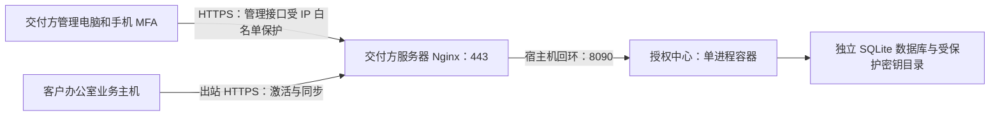

# 授权中心部署说明：无界面服务器

本手册面向交付方运维人员，说明如何在没有桌面环境的服务器上部署独立授权中心。推荐方案是 **Ubuntu 24.04 LTS + Docker Compose + 宿主机 Nginx + HTTPS**，支持只有固定公网 IP、没有域名的场景。

服务器不需要桌面或浏览器。通过 SSH 完成部署和恢复，在运维电脑的浏览器中进行日常管理，手机身份验证器提供 MFA 验证码。

> 本功能源于本项目的 `feature/instance-licensing` 开发分支；上游 `TencentCloud/Octop` 不保证包含它。生产部署应使用交付方确认过的本项目版本，并核对具体提交和交付包。不要直接替换现有客户实例：该版本默认需要授权，缺少有效授权时业务会锁定。

## 目录

1. [部署边界与拓扑](#1-部署边界与拓扑)
2. [准备服务器与参数](#2-准备服务器与参数)
3. [安装 Docker、Nginx 和基础工具](#3-安装-dockernginx-和基础工具)
4. [交付源代码与准备数据目录](#4-交付源代码与准备数据目录)
5. [固定 IP 的 HTTPS 证书](#5-固定-ip-的-https-证书)
6. [Docker 网络、环境文件与构建](#6-docker-网络环境文件与构建)
7. [初始化管理员与 MFA](#7-初始化管理员与-mfa)
8. [启动中心及配置 HTTPS 反向代理](#8-启动中心及配置-https-反向代理)
9. [证书自动续期](#9-证书自动续期)
10. [客户办公室主机接入](#10-客户办公室主机接入)
11. [日常授权操作](#11-日常授权操作)
12. [备份与恢复](#12-备份与恢复)
13. [升级、迁移与签名密钥轮换](#13-升级迁移与签名密钥轮换)
14. [不使用 Docker 的 systemd 方案](#14-不使用-docker-的-systemd-方案)
15. [监控与故障排查](#15-监控与故障排查)
16. [上线验收与当前验证范围](#16-上线验收与当前验证范围)
17. [参考资料](#17-参考资料)

## 1. 部署边界与拓扑



- 授权中心放在交付方控制的服务器上，不放在客户办公室业务主机上。客户只能拿到业务平台的 `enterprise_admin` 账号。
- 中心账号、中心签发私钥、MFA 密钥及服务器 SSH/Docker 权限不得交付客户。
- 客户办公室主机只需出站访问中心，不要求开放入站公网端口。
- 中心使用自己的 SQLite，不依赖客户业务数据库、LLM、Redis 或外部队列。
- 当前只支持一个工作进程。不能用 `--workers 2`、多副本或共享网络盘上的 SQLite 代替高可用设计。
- Docker 管理权基本等价于宿主机管理权。不能把客户加入中心服务器的 `docker` 组。
- 应用授权不是防 root 的 DRM；不能阻止拥有宿主机管理员权限的人修改程序，也不能撤回已导出的数据。

## 2. 准备服务器与参数

### 2.1 服务器条件

| 项目 | 要求或建议 |
| --- | --- |
| 系统 | Ubuntu 24.04 LTS，64 位，SSH 可达 |
| 配置 | 小规模部署可先选 2 核、4 GB 内存、30 GB 以上磁盘；这是容量建议，不是压测结论 |
| 地址 | 固定公网 IP，或稳定域名；IP 变化要同步更新证书与客户配置 |
| 存储 | 本地持久磁盘，数据目录独立于镜像和源代码目录 |
| 时间 | 服务器、客户主机及 MFA 手机启用时间同步 |
| 出站网络 | 构建时可访问 Docker 镜像仓库、Python/npm 包源；运行时证书续期可访问 CA |
| 运维 | 有备份目的地、证书自动续期和故障告警负责人 |

推荐用专用服务器。已有 Docker、Nginx 或 443 业务的主机应先核对现有配置，不卸载现有运行时，不覆盖其他站点。

### 2.2 示例参数

全文地址均为文档示例，必须替换，不能直接使用：

| 参数 | 示例 | 用途 |
| --- | --- | --- |
| 中心公网 IP | `203.0.113.10` | 浏览器和客户访问中心 |
| 运维公网 IP | `198.51.100.25` | 允许访问管理接口的出口 IP |
| 运维 VPN 网段 | `10.40.0.0/24` | 可选，填写服务器实际看到的来源网段 |
| 中心基目录 | `/srv/maitu-license-center` | 源代码、持久数据与备份 |
| 中心后端端口 | `8090` | 只绑定宿主机 `127.0.0.1` |
| 中心时区 | `Asia/Shanghai` | 管理页面的日期输入和显示 |
| 首个中心账号 | `license-owner` | 交付方所有者，不是客户企业管理员 |

### 2.3 网络与防火墙

| 入站端口 | 开放对象 | 说明 |
| --- | --- | --- |
| SSH 实际端口 | 运维 IP/VPN | 不一定是 22；修改防火墙前保留当前 SSH 通道 |
| 443/TCP | 客户主机与运维电脑 | HTTPS；管理 API 另加 Nginx 白名单 |
| 80/TCP | 公网 CA 校验 | 本手册的 ACME HTTP-01 方案需要，自动续期期间也要可达 |
| 8090/TCP | 不对公网开放 | Docker 映射保持 `127.0.0.1:8090:8090` |

云安全组和宿主机防火墙均需核对。Docker 发布端口可能绕过 UFW，不能仅靠 UFW 拦截暴露到 `0.0.0.0` 的容器端口。不要开放 Docker API 的 2375/2376 给客户。

```bash
sudo timedatectl set-ntp true
timedatectl status
sudo ss -lntp
sudo ufw status verbose
```

不要未经核对就执行防火墙重置或 `ufw enable`。中心暂不可达时，客户可在有效缓存范围内继续运行；客户主机关机或自身业务依赖不可用则是另外的可用性问题。

## 3. 安装 Docker、Nginx 和基础工具

以下面向全新 Ubuntu 主机。若存在旧 Docker/containerd 包，按 Docker 官方文档评估冲突，不在有业务的主机上直接卸载。

```bash
sudo apt-get update
sudo apt-get install -y ca-certificates curl gnupg nginx openssl python3
sudo install -m 0755 -d /etc/apt/keyrings
sudo curl -fsSL https://download.docker.com/linux/ubuntu/gpg \
  -o /etc/apt/keyrings/docker.asc
sudo chmod a+r /etc/apt/keyrings/docker.asc

sudo tee /etc/apt/sources.list.d/docker.sources >/dev/null <<EOF
Types: deb
URIs: https://download.docker.com/linux/ubuntu
Suites: $(. /etc/os-release && echo "${UBUNTU_CODENAME:-$VERSION_CODENAME}")
Components: stable
Architectures: $(dpkg --print-architecture)
Signed-By: /etc/apt/keyrings/docker.asc
EOF

sudo apt-get update
sudo apt-get install -y docker-ce docker-ce-cli containerd.io \
  docker-buildx-plugin docker-compose-plugin
sudo systemctl enable --now docker nginx
sudo docker version
sudo docker compose version
sudo docker run --rm hello-world
```

所有中心 Docker 命令在本手册中通过 `sudo` 执行。无需为客户或不受信任的用户增加 Docker 权限。

## 4. 交付源代码与准备数据目录

### 4.1 制作交付包

在包含本功能的工作区制作包。下面在 Bash/Git Bash 中执行，将 `WORKTREE` 改成真实工作区路径；使用允许列表，避免把中心真实数据和密钥一起打包：

```bash
WORKTREE=/path/to/AIPlatform-instance-licensing
tar -C "$WORKTREE/services/license-center" \
  --exclude='dashboard/node_modules' \
  --exclude='dashboard/tsconfig.tsbuildinfo' \
  --exclude='license_center/__pycache__' \
  -czf "$HOME/license-center-source.tar.gz" \
  Dockerfile docker-compose.yml nginx.conf.example .dockerignore \
  pyproject.toml uv.lock license_center dashboard
sha256sum "$HOME/license-center-source.tar.gz"
scp "$HOME/license-center-source.tar.gz" deploy@203.0.113.10:/tmp/
```

也可以交付已构建、经验证的容器镜像。未经确认的上游下载包不能替代本项目交付包。交付清单需记录版本/提交和包的 SHA-256。

### 4.2 解包及目录权限

以下在服务器 SSH 会话中执行。使用全新目录，不覆盖已有数据：

```bash
sudo install -d -m 0755 /srv/maitu-license-center/source/services/license-center
sudo tar -xzf /tmp/license-center-source.tar.gz \
  -C /srv/maitu-license-center/source/services/license-center
sudo install -d -m 0700 -o 10001 -g 10001 /srv/maitu-license-center/data
sudo install -d -m 0700 /srv/maitu-license-center/backups
sudo install -d -m 0755 /etc/maitu-license-center
```

容器固定以 UID/GID `10001:10001` 运行。宿主机是否有同名用户不重要，但应检查是否有不受信任的宿主机账号占用这个 UID。不要用 `chmod 777` 修复权限。

默认数据布局：

```text
/srv/maitu-license-center/data/
  center.sqlite3              客户、实例、授权、管理员、会话与审计
  center.sqlite3-wal / -shm    SQLite 运行时文件
  keys/
    encryption.key            解密签发私钥和管理员 MFA 的加密密钥
    license-*.ed25519.fernet   加密保存的 Ed25519 签发私钥
```

源代码升级不应改变 `/data` 的持久绑定位置。TLS 私钥是另外一类密钥，由 Nginx 管理，不能挂载进中心容器。

## 5. 固定 IP 的 HTTPS 证书

### 5.1 证书要求

只有固定 IP 也可以使用 HTTPS。证书必须有该地址的 **IP 类型 subjectAltName**，证书链必须受客户主机和管理浏览器信任。只有 Common Name、仅有域名 SAN，或随便生成的自签名证书都不够。

下面提供 Let's Encrypt + Certbot 的 IP 证书流程。官方说明要求支持 IP webroot 的 **Certbot 5.4 或更高版本**，IP 证书约 160 小时有效，必须自动续期。不要假定 Ubuntu 自带 apt 版本满足要求。

### 5.2 安装合适的 Certbot

没有冲突的旧 Certbot 时，可使用官方推荐的 snap 安装方式；已有安装应先按官方指引处理，不同时混用 apt/snap 两套服务：

```bash
sudo snap install --classic certbot
/snap/bin/certbot --version
```

若输出低于 5.4，先升级客户端，不能继续复制本节 IP 参数。没有 snap 的环境可按 Certbot 官方方式安装满足版本要求的客户端。

### 5.3 为 HTTP-01 校验提供 webroot

公网 IP 的 80 端口必须能直接到达这台服务器。下面适用于专用服务器；已有 80 站点应把 challenge location 合并到现有站点，而不是制造多个默认站点。

```bash
sudo install -d -m 0755 /var/www/maitu-acme/.well-known/acme-challenge
sudo tee /etc/nginx/sites-available/maitu-license-acme >/dev/null <<'EOF'
server {
    listen 80;
    server_name 203.0.113.10;
    location ^~ /.well-known/acme-challenge/ {
        root /var/www/maitu-acme;
    }
    location / {
        return 404;
    }
}
EOF
sudo ln -s /etc/nginx/sites-available/maitu-license-acme \
  /etc/nginx/sites-enabled/maitu-license-acme
sudo nginx -t
sudo systemctl reload nginx
```

签发前从服务器之外确认 challenge 路径可达。CA 需要访问的是公网地址，不是 `127.0.0.1`。不要把整个中心管理后台放到明文 80 端口。

### 5.4 申请正式 IP 证书

将 IP 与邮箱替换为实际值：

```bash
sudo /snap/bin/certbot certonly \
  --webroot --webroot-path /var/www/maitu-acme \
  --preferred-profile shortlived \
  --ip-address 203.0.113.10 \
  --cert-name maitu-license-center \
  --email ops@example.com --agree-tos --non-interactive

sudo openssl x509 \
  -in /etc/letsencrypt/live/maitu-license-center/fullchain.pem \
  -noout -dates -ext subjectAltName
sudo install -m 0644 \
  /etc/letsencrypt/live/maitu-license-center/fullchain.pem \
  /etc/maitu-license-center/fullchain.pem
```

预演可以使用 `--staging`，但 staging 证书不受公共信任，不能用于客户交付。若曾签发 staging 证书，正式签发前核对 Certbot 的证书名称与 CA 配置，不把 staging 文件当成正式证书。

如果使用商业 CA，安装其签发的 IP 证书链和私钥，并按其规则续期。如果采用私有 CA，必须明确为管理浏览器安装可信根、为客户配置 `OCTOP_LICENSE_CA_FILE`；不得让用户忽略浏览器警告，也不得关闭客户端验签。

## 6. Docker 网络、环境文件与构建

### 6.1 创建专用网络

```bash
sudo docker network create maitu-license-center
sudo docker network inspect maitu-license-center \
  --format '{{range .IPAM.Config}}{{.Gateway}}{{println}}{{end}}'
```

如果网络已存在，先 inspect，不重复创建或删除正在使用的网络。记录 IPv4 网关，例如 `172.30.0.1`；这不是固定值。

Nginx 在宿主机、应用在容器时，应用通常看到 Docker 网关为代理来源。应将实际来源地址配置到可信代理集合中；不是填写管理员公网 IP，更不是填写 `*`。独立网络不要接入不受信任的容器。

### 6.2 写环境文件

```bash
sudo tee /etc/maitu-license-center/center.env >/dev/null <<'EOF'
LICENSE_CENTER_DATA=/srv/maitu-license-center/data
LICENSE_CENTER_PORT=8090
LICENSE_CENTER_TIMEZONE=Asia/Shanghai
LICENSE_CENTER_TLS_CERT_HOST=/etc/maitu-license-center/fullchain.pem
LICENSE_CENTER_TRUSTED_PROXY_IPS=172.30.0.1
EOF
sudo chmod 0600 /etc/maitu-license-center/center.env
```

必须把 `172.30.0.1` 替换为刚才得到的实际网关。当前 Compose 配置在容器内固定设置：

| 项目 | 容器内配置 |
| --- | --- |
| 数据目录 | `/data` |
| 后端端口 | `8090` |
| Cookie | `LICENSE_CENTER_COOKIE_SECURE=1` |
| 可读取的公共证书 | `/run/certificates/fullchain.pem` |
| 权限 | 非 root、只读根文件系统、删除 capabilities、禁止新增权限 |

`LICENSE_CENTER_PORT` 只改变宿主机映射端口；若改变，Nginx 的 upstream 也必须相应改变。生产不能把安全 Cookie 改成 0。

### 6.3 定义本次 SSH 会话的便捷命令

后续所有 `dc` 命令都指向同一个配置和数据目录：

```bash
CENTER_APP=/srv/maitu-license-center/source/services/license-center
dc() {
    sudo docker compose --env-file /etc/maitu-license-center/center.env \
      -f "$CENTER_APP/docker-compose.yml" "$@"
}
dc config --quiet
dc build
```

重新登录 SSH 后需要重新定义这段函数。`dc config --quiet` 成功只证明配置可解析，不证明镜像构建、数据权限或 HTTPS 已正确。

Docker 构建自动安装前端依赖、构建管理页面并安装中心 Python 依赖。宿主机不需要 Node 或 Python 开发环境。

## 7. 初始化管理员与 MFA

首次初始化使用真实交互终端；不要使用 `-T`，不要把密码写进命令行：

```bash
dc run --rm license-center init --username license-owner
```

按终端提示完成：

1. 输入至少 12 位强密码，再输入一次确认；推荐使用密码管理器生成的独立密码。
2. 终端显示一次 `TOTP secret` 和配对 URI。
3. 在 Microsoft Authenticator、Google Authenticator 等应用中添加账号，选择手动输入密钥，类型为“基于时间”。
4. 将当前 6 位动态验证码输入终端，完成所有者激活。
5. 保存 MFA 恢复材料到交付方受控密码库，不保存到源代码、公共日志或客户交付包。

成功后数据库有 owner 和初始签发密钥。重复 `init` 会拒绝已有管理员；这不是修复密码或重新部署的方法。

验证码过期时等下一组；同一验证码已成功使用后再次登录可能因防重放被拒绝。若长期失败，检查手机和服务器时间。

导出公开验签密钥：

```bash
umask 077
dc run --rm -T license-center export-trust > "$HOME/trusted-keys.json"
python3 -m json.tool "$HOME/trusted-keys.json" >/dev/null
```

默认输出只有公开密钥 JSON，形式为 `kid → PEM`。中心签发私钥和 `encryption.key` 都不包含在这个文件中。客户端需要防篡改的公开密钥文件，不需要中心登录账号。

## 8. 启动中心及配置 HTTPS 反向代理

### 8.1 启动后台服务

```bash
dc up -d
dc ps
dc logs --tail=100 license-center
curl --fail http://127.0.0.1:8090/health
sudo ss -lntp
```

本机健康接口应返回 `{"status":"ok"}`。检查 8090 只绑定回环，不绑定 `0.0.0.0`。镜像内健康检查正常也不能代替公网 HTTPS 检查。

`restart: unless-stopped` 配合 Docker 开机启动可以在服务器重启后恢复服务；人工 `stop` 后不应期待 Docker 自动重启它。

### 8.2 Nginx 配置

仓库提供 `services/license-center/nginx.conf.example`。以下配置使用本手册的证书路径，适用于独立服务器。把示例 IP/VPN 网段替换成真实值，避免与已有 443 默认站点冲突。

```nginx
server {
    listen 443 ssl;
    server_name 203.0.113.10;
    ssl_certificate /etc/letsencrypt/live/maitu-license-center/fullchain.pem;
    ssl_certificate_key /etc/letsencrypt/live/maitu-license-center/privkey.pem;
    ssl_protocols TLSv1.2 TLSv1.3;
    client_max_body_size 64k;
    add_header X-Content-Type-Options nosniff always;
    add_header Referrer-Policy no-referrer always;
    add_header X-Frame-Options DENY always;

    location /api/v1/admin/ {
        allow 127.0.0.1;
        allow ::1;
        allow 198.51.100.25;
        allow 10.40.0.0/24;
        deny all;
        proxy_pass http://127.0.0.1:8090;
        proxy_set_header Host $host;
        proxy_set_header X-Forwarded-Proto https;
        proxy_set_header X-Forwarded-For $remote_addr;
        proxy_read_timeout 15s;
    }
    location / {
        proxy_pass http://127.0.0.1:8090;
        proxy_set_header Host $host;
        proxy_set_header X-Forwarded-Proto https;
        proxy_set_header X-Forwarded-For $remote_addr;
        proxy_read_timeout 15s;
    }
}
```

将配置保存到 `/etc/nginx/sites-available/maitu-license-center`，再启用：

```bash
sudo ln -s /etc/nginx/sites-available/maitu-license-center \
  /etc/nginx/sites-enabled/maitu-license-center
sudo nginx -t
sudo systemctl reload nginx
curl --fail https://203.0.113.10/health
```

管理白名单保护整个 `/api/v1/admin/`，包括登录接口，而不是只保护页面入口。静态登录页面可公开加载，不等于能访问管理数据。`/api/v1/instance/` 必须让客户主机正常访问。

若前面还有 CDN/负载均衡，Nginx 看到的 `$remote_addr` 会变化。不要直接信任客户端传来的 `X-Forwarded-For`；应先按真实代理拓扑配置可信来源和 real-IP 规则，再验证白名单。

### 8.3 管理电脑登录

从允许的运维出口打开 `https://203.0.113.10/`，输入 `license-owner`、独立密码和手机当前验证码。页面应无证书警告，登录成功后可以看到客户管理、实例与授权、激活码、审计、操作员及系统与密钥。

角色分工：owner 管理中心身份及签名密钥，operator 处理日常客户授权，reader 只读。按岗位建立个人账号，不共享所有者账号。

### 8.4 验证限制生效

从白名单来源请求管理会话接口，未登录应收到 401；从非白名单来源应收到 Nginx 403：

```bash
curl -i https://203.0.113.10/api/v1/admin/session
```

同时从客户办公室网络验证 `/health` 及正常激活/同步。客户网络不能被管理白名单误伤。不要使用 `curl -k` 或客户端 `verify=False` 验收 HTTPS。

## 9. 证书自动续期

IP 短期证书不能依赖手动记日期。确认 Certbot 的定时任务已启用：

```bash
systemctl list-timers --all
sudo /snap/bin/certbot certificates
```

安装以下续期成功钩子，保存为 `/etc/letsencrypt/renewal-hooks/deploy/maitu-license-center.sh`。仅供本手册 Docker 方案使用：

```bash
#!/bin/sh
set -eu
[ "${RENEWED_LINEAGE:-}" = '/etc/letsencrypt/live/maitu-license-center' ] || exit 0
install -m 0644 "$RENEWED_LINEAGE/fullchain.pem" /etc/maitu-license-center/fullchain.pem
nginx -t
systemctl reload nginx
/usr/bin/docker compose --env-file /etc/maitu-license-center/center.env \
  -f /srv/maitu-license-center/source/services/license-center/docker-compose.yml \
  up -d --no-deps --force-recreate license-center
```

```bash
sudo chmod 0750 /etc/letsencrypt/renewal-hooks/deploy/maitu-license-center.sh
sudo /snap/bin/certbot renew --dry-run
```

`--dry-run` 成功不等于 deploy hook 已执行。维护窗口可以显式验证钩子；它会重建中心容器，不在不合适的时段盲目运行：

```bash
sudo env RENEWED_LINEAGE=/etc/letsencrypt/live/maitu-license-center \
  /etc/letsencrypt/renewal-hooks/deploy/maitu-license-center.sh
curl --fail https://203.0.113.10/health
```

为什么重建容器：公开证书是单文件 bind mount；更新或原子替换宿主机文件后，运行中容器可能仍看到旧 inode。仅 Nginx reload 不一定刷新中心页面显示的证书状态。此操作不删除 `/data`。

为续期失败设置告警，并从外部监控实际 HTTPS 证书到期时间。中心“系统与密钥”页面读取的是本地证书文件，不能证明外部代理确实使用该证书。若选择其他 CA，应提供等价的自动续期和重载流程。

## 10. 客户办公室主机接入

只把公开 `trusted-keys.json` 交给主机运维人员。中心与客户是两个独立系统：

| 客户配置 | 设置 |
| --- | --- |
| `OCTOP_LICENSE_SERVER_URL` | `https://203.0.113.10`，中心根地址，不附加 `/api/v1` |
| `OCTOP_LICENSE_TRUST_FILE` | 只读公开验签 JSON 的实际路径 |
| `OCTOP_LICENSE_CA_FILE` | 私有 CA 时填写可信根 PEM；公共 CA 通常不用设置 |
| `OCTOP_LICENSE_CONTACT` | 交付方联系电话或支持方式 |

Linux Docker 客户使用 `docker/docker-compose.licensing.yml` 叠加原业务 Compose，并设置 `OCTOP_LICENSE_TRUST_DIR`；使用容器内路径，而不是宿主机路径配置验签文件。已有业务的 `OCTOP_DATA` 必须复用，升级前先备份并在隔离副本验证。

中心创建客户，生成激活码时分别确认“授权截止时间”和“激活码使用期限”。客户管理员在业务平台锁定页输入激活码，或由主机运维执行 `octop license activate`。激活码只显示一次，不写到公共日志；同一激活码不用于多台不同主机。

客户侧详细命令和数据边界见 [实例授权部署与交付操作](instance-license-operations.md#3-办公室业务主机)。不要复制中心 `keys/`、数据库、owner 密码或 MFA 密钥到办公室主机。

## 11. 日常授权操作

| 需求 | 中心操作 | 客户操作 |
| --- | --- | --- |
| 延长试用 | 在实例授权中延期到新的、更晚截止时间，填写原因 | 点击“检查授权”或等待同步 |
| 提前停用 | 撤销授权并填写原因 | 下一次成功同步后锁定 |
| 恢复撤销 | 恢复授权；原期限已过时设置未来截止时间 | 同步成功后恢复 |
| 停用整个客户 | 停用客户记录 | 该客户实例同步后拒绝业务 |
| 更换主机 | 替换/解绑旧实例，生成新激活码 | 新主机以新身份激活；不复制旧实例私钥 |

重要行为：

- 正常到期按主机有效签名截止时间锁定，不等待下一次中心联网。
- 正常联网约每小时同步；锁定状态约每 5 分钟同步，失败有退避和抖动，手动操作有限频。
- 中心撤销不是即时推送。断网时有效缓存最多支持 24 小时，且不能超过实际授权截止时间；没有额外到期宽限。
- 锁定保留登录、数据和授权维护入口，不代表所有业务读取/导出仍可用。
- 延期是延长，不能用“延期”把已有授权改成更早的期限。快速验证锁定可使用撤销/恢复；测试自然到期应建立新的短期测试实例。
- 敏感操作可能要求再次输入当前 MFA；版本冲突要刷新后核对，不直接覆盖他人的修改。

### 11.1 遗失 MFA 或中心密码

由交付方在服务器本地操作：

```bash
dc run --rm license-center recover license-owner --confirm
```

设置新密码，手动配对终端显示的新 TOTP 密钥，输入当前验证码。旧会话失效，该过程有审计记录。恢复中断或验证码失败时账号保持停用，需重新完成恢复；不能使用首次 `init` 或重建空数据库解决。

## 12. 备份与恢复

### 12.1 必须备份什么

| 内容 | 必要性 |
| --- | --- |
| `center.sqlite3` 一致性快照 | 授权、绑定、管理员、版本和审计 |
| `keys/` 全目录 | 所有签名私钥及 `encryption.key`；缺少加密密钥不能恢复 MFA/签发 |
| 部署配置与交付版本记录 | 重建环境，不能误指向空数据目录 |
| TLS 证书/私钥或重新签发能力 | 重建可信 HTTPS；不与授权签名密钥混淆 |

不能只在线复制 SQLite 主文件：WAL 内可能有尚未合并的已提交数据。使用 CLI 的 SQLite backup API。私钥虽以加密文件保存，但与 `encryption.key` 一起泄露后仍可解密，所以完整备份必须加密并异地存放。

### 12.2 一致性备份演练

下面采用短维护窗口，停止中心后备份，避免数据库快照与密钥轮换同时发生。已有客户可以在有效缓存范围内继续用，仍需避开临近到期的客户。

先在受控备份体系准备 GPG 加密接收方：将其**公开密钥**导入服务器 root 的 GPG keyring，人工核对完整指纹；解密私钥放在离线恢复环境，不放在中心服务器。以下 `BACKUP_RECIPIENT` 必须替换为该完整指纹。

```bash
# 只导入已核实来源的备份接收方公开密钥，不导入其解密私钥。
sudo gpg --import /path/to/backup-recipient-public.asc
STAMP=$(date -u +%Y%m%dT%H%M%SZ)
BACKUP_RECIPIENT=REPLACE_WITH_VERIFIED_FULL_GPG_FINGERPRINT
sudo gpg --list-keys --with-fingerprint "$BACKUP_RECIPIENT"
dc stop license-center
dc run --rm -T license-center backup /data/center-backup.sqlite3

# Bash 的 pipefail 保证 tar 失败时不会把空备份误认为成功。
set -o pipefail
sudo tar -C /srv/maitu-license-center/data -cf - center-backup.sqlite3 keys \
  | sudo gpg --batch --trust-model always --encrypt \
    --recipient "$BACKUP_RECIPIENT" \
    --output "/srv/maitu-license-center/backups/center-${STAMP}.tar.gpg"

dc start license-center
curl --fail https://203.0.113.10/health
sudo sha256sum "/srv/maitu-license-center/backups/center-${STAMP}.tar.gpg"
```

每一步都检查退出状态。若备份失败，不把归档当成有效备份；确认中心恢复运行后修复备份任务。快照文件留在受保护数据目录，可在归档验收后删除这一快照，不删除运行数据库或 `keys/`。

通过受控通道保存加密归档、环境配置、交付包校验和及备份时间到另一台机器。按业务变化频率确定每日备份和保留策略；每次升级、轮换密钥及大批授权变更前额外备份。定期在独立环境实际解密并测试恢复，而不是只检查文件存在。

### 12.3 恢复步骤

1. 确定备份的时间、版本、SHA-256 和对应密钥材料，保留当前数据副本。
2. 在受控恢复环境解密归档。解密私钥不要临时散落到生产主机；通过受控 SSH 通道传输明文恢复材料，并限制恢复目录为 0700。
3. 停止中心，保存当前数据目录到独立位置；不要对原数据执行 `rm -rf`。
4. 把备份快照作为 `/data/restore-input.sqlite3`，恢复完整 `keys/`，所有者设为 `10001:10001`，私钥文件 0600、目录 0700。
5. 假定解密并核验后的材料已安全放到 `/srv/maitu-license-center/restore`，包含 `center-backup.sqlite3` 与 `keys/`。在相同交付版本上执行下列操作；当前数据副本需要足够的独立磁盘空间：

```bash
STAMP=$(date -u +%Y%m%dT%H%M%SZ)
DATA=/srv/maitu-license-center/data
RESTORE=/srv/maitu-license-center/restore
sudo test -f "$RESTORE/center-backup.sqlite3"
sudo test -f "$RESTORE/keys/encryption.key"
dc stop license-center
sudo cp -a "$DATA" "${DATA}.before-restore-${STAMP}"
sudo install -m 0600 -o 10001 -g 10001 \
  "$RESTORE/center-backup.sqlite3" "$DATA/restore-input.sqlite3"
sudo install -d -m 0700 -o 10001 -g 10001 "$DATA/keys"
sudo cp -a "$RESTORE/keys/." "$DATA/keys/"
sudo chown -R 10001:10001 "$DATA/keys"
sudo find "$DATA/keys" -type d -exec chmod 0700 {} +
sudo find "$DATA/keys" -type f -exec chmod 0600 {} +
dc run --rm -T license-center restore /data/restore-input.sqlite3 --confirm
dc up -d
curl --fail https://203.0.113.10/health
```

6. 管理员登录，核对客户、绑定、签名 kid、授权版本和审计，选择现有客户验证同步。
7. 验收后清理明文恢复材料；保留加密备份及审计记录。

不要执行 `init` 创建新 owner/新签发身份来代替恢复。恢复工具会校验 SQLite 完整性并处理旧 WAL/SHM，但不会替你恢复密钥或确认备份业务正确。

旧数据库快照可能低于客户已见的授权版本，客户会拒绝降级。这是保护，不是缓存故障。应恢复更完整的最新备份，或在核对审计后通过合法授权操作发布高于客户已见栅栏的版本；单次恢复/延期不保证跨过所有已见版本。不得删除客户缓存、改栅栏或回滚时钟来解除拒绝。

## 13. 升级、迁移与签名密钥轮换

### 13.1 中心升级

1. 在隔离环境验证新交付版本及其迁移；记录当前镜像 ID，保留原交付包/镜像。
2. 做数据库和密钥的成套备份，安排维护窗口，停止中心。
3. 将新源代码部署到新的交付目录，使用相同环境文件、Compose project 名、外部网络和数据目录。
4. 核对配置、构建新镜像并启动。
5. 检查健康、登录、授权管理、现有客户同步和日志。

使用本手册路径时，新包部署完成后的命令是：

```bash
dc config --quiet
dc build
dc up -d
```

数据库迁移在启动时执行。不能假定旧镜像能读取新 schema；回退需要经过验证的原版本加匹配的数据/密钥备份，并处理客户已见版本栅栏。不要只回滚二进制或只回滚数据库。

### 13.2 签名密钥轮换

这是授权签发密钥，不是 HTTPS 证书。按照顺序：

```bash
dc run --rm -T license-center stage-key
dc run --rm -T license-center export-trust > "$HOME/trusted-keys-next.json"
```

先将包含新旧公钥的 JSON 分发到每台客户主机，保持只读保护，重启客户服务加载新的信任集合，并确认旧签名同步仍正常。然后才切换：

```bash
dc run --rm -T license-center activate-key REPLACE_WITH_STAGED_KID --confirm
```

再次逐台刷新客户授权，验证新 kid。保留旧公开密钥覆盖现存缓存；不要提前删除退休密钥的备份。仅复制公钥文件、不重启客户加载就切换签发密钥，会导致客户拒绝新凭证。

### 13.3 更换服务器或公网 IP

先备份并恢复原数据库和全部密钥，不能重建全新中心替代旧中心。新 IP 要重新取得包含新 IP 的证书，重做 Nginx 白名单及代理信任地址，再更新每台客户的 `OCTOP_LICENSE_SERVER_URL` 并重启加载。

在迁移窗口避免新旧中心同时允许管理写入，防止授权版本分叉。规划停机及缓存期限；验收现有客户同步后再下线旧中心。更换中心地址通常不需要重新生成客户实例身份或激活码，前提是原绑定和签发密钥已完整恢复。

## 14. 不使用 Docker 的 systemd 方案

选择 Docker 或原生其中一种，不在同一个数据目录同时启动两套服务。以下是替代方案，不要求和前文 Docker 步骤一起执行。

### 14.1 交付已构建的 wheel

在开发/构建机器先构建管理页面，再构建独立 Python 包：

```bash
# 在 services/license-center/dashboard/ 执行：
npm ci
npm run build
# 在 services/license-center/ 执行：
uv build --wheel
```

把 `dist/maitu_license_center-1.0.0-py3-none-any.whl` 上传服务器；实际文件名随交付版本变化。构建好的包包含管理页面和数据库迁移，服务器运行时不需要 Node。

```bash
sudo apt-get install -y python3 python3-venv
sudo useradd --system --user-group --home /var/lib/maitu-license-center \
  --shell /usr/sbin/nologin maitu-license-center
sudo install -d -m 0755 /opt/maitu-license-center
sudo python3 -m venv /opt/maitu-license-center/venv
sudo /opt/maitu-license-center/venv/bin/pip install \
  /tmp/maitu_license_center-1.0.0-py3-none-any.whl
sudo install -d -m 0700 -o maitu-license-center -g maitu-license-center \
  /var/lib/maitu-license-center
```

已有专用用户时不重复创建。不要直接把 Docker 的 UID 10001 权限方案套给一个不同 UID 的原生服务用户。

### 14.2 环境与初始化

先按前文取得可信 HTTPS 证书、安装公共证书副本及 Nginx。写 `/etc/maitu-license-center/native.env`：

```ini
LICENSE_CENTER_DATA=/var/lib/maitu-license-center
LICENSE_CENTER_COOKIE_SECURE=1
LICENSE_CENTER_TIMEZONE=Asia/Shanghai
LICENSE_CENTER_TRUSTED_PROXY_IPS=127.0.0.1
LICENSE_CENTER_TLS_CERT=/etc/maitu-license-center/fullchain.pem
PYTHONDONTWRITEBYTECODE=1
PYTHONUNBUFFERED=1
```

```bash
sudo chmod 0600 /etc/maitu-license-center/native.env
sudo -u maitu-license-center env \
  LICENSE_CENTER_DATA=/var/lib/maitu-license-center \
  /opt/maitu-license-center/venv/bin/license-center init --username license-owner
```

按第 7 节完成 MFA。原生 Nginx 通过回环连接应用，所以可信代理来源是 `127.0.0.1`，不是 Docker 网关。

### 14.3 systemd 单元

保存到 `/etc/systemd/system/maitu-license-center.service`：

```ini
[Unit]
Description=Maitu License Center
After=network-online.target
Wants=network-online.target

[Service]
Type=simple
User=maitu-license-center
Group=maitu-license-center
WorkingDirectory=/opt/maitu-license-center
EnvironmentFile=/etc/maitu-license-center/native.env
ExecStart=/opt/maitu-license-center/venv/bin/license-center run --host 127.0.0.1 --port 8090 --workers 1
Restart=on-failure
RestartSec=5
UMask=0077
NoNewPrivileges=true
PrivateTmp=true
ProtectSystem=strict
ProtectHome=true
ReadWritePaths=/var/lib/maitu-license-center

[Install]
WantedBy=multi-user.target
```

```bash
sudo systemctl daemon-reload
sudo systemctl enable --now maitu-license-center
sudo systemctl status maitu-license-center
sudo journalctl -u maitu-license-center -n 100 --no-pager
curl --fail http://127.0.0.1:8090/health
```

Nginx、白名单、HTTPS 和客户接入与主方案一致。原生续期钩子保留公共证书复制与 Nginx reload，把 Docker 重建命令替换为 `systemctl restart maitu-license-center`。

手动 CLI 不自动读取 systemd 的环境文件。备份、恢复或轮换时必须明确传入相同 `LICENSE_CENTER_DATA`；否则默认 `./data` 可能指向错误目录。例如：

```bash
sudo -u maitu-license-center env \
  LICENSE_CENTER_DATA=/var/lib/maitu-license-center \
  /opt/maitu-license-center/venv/bin/license-center export-trust
```

不要用 `nohup ... &` 或依赖 SSH 会话长期保持来替代 systemd。

## 15. 监控与故障排查

### 15.1 例行监控

监控实际 HTTPS `/health`、外部证书到期时间、Docker/systemd 状态、磁盘空间、备份任务、备份恢复演练及客户最近同步时间。中心当前没有自动续证、完整告警平台或日志保留调度器，必须由运维配置。

```bash
dc ps
dc logs --tail=100 license-center
sudo journalctl -u nginx -n 100 --no-pager
sudo nginx -t
df -h
```

按实际运维策略配置 Docker/应用日志轮转和备份清理，避免磁盘满。日志中不得打印明文密码、TOTP 密钥、激活码、完整签名凭证或客户实例私钥。

### 15.2 排障对照

| 现象 | 首先检查 | 不要做什么 |
| --- | --- | --- |
| 浏览器证书警告 | IP SAN、完整链、证书到期和是否误用 staging | 不要忽略警告上线 |
| HTTPS 返回 `https_required` | Nginx 是否覆盖 X-Forwarded-Proto、实际代理 IP 是否可信 | 不要设代理信任为 `*` |
| 登录接口 Nginx 403 | 当前运维出口 IP/VPN 与白名单 | 不要为方便放开所有管理来源 |
| 登录后立即失效 | HTTPS、安全 Cookie、请求是否始终用同一中心地址 | 不要把生产 Cookie Secure 设为 0 |
| MFA 验证失败 | 手机/服务器时间、密钥是否正确、代码是否已使用 | 不要把验证码当固定密码 |
| 近期 MFA 要求 | 输入下一组当前动态验证码重新确认 | 不要关闭敏感操作确认 |
| SQLite 无法写入 | 宿主机数据目录 UID/GID、只读挂载、磁盘空间 | 不要 chmod 777 |
| 页面 404/只有 API | 镜像是否完成前端构建、wheel 是否包含管理页面 | 不要在生产运行 Vite 开发服务器 |
| 客户新凭证被拒绝 | 公开信任 JSON、签名 kid、版本栅栏、中心恢复是否降级 | 不要删除客户缓存或关闭验签 |
| 主机仍锁定 | 实际截止时间、撤销/客户停用状态、同步错误与出站 TLS | 不要直接改客户本地到期字段 |
| 证书续期后中心显示旧日期 | 公共证书副本、文件挂载 inode、是否重建/重启中心 | 不要只更新页面缓存 |
| 服务器重启后不运行 | Docker/systemd 是否启用、是否曾人工 stop、持久路径 | 不要重新 init 生成新身份 |

中心接口文档在 `/docs`，OpenAPI 在 `/openapi.json`。它们不同于客户业务平台的 `/api/docs`。如有不公开中心 API 元数据的要求，可额外在 Nginx 限制这两个路径；管理 API 本身仍必须做白名单和认证。

## 16. 上线验收与当前验证范围

### 16.1 交付验收清单

- [ ] 公网固定 IP/域名与实际 HTTPS 证书匹配，外部客户端不跳过验证即可成功访问。
- [ ] 8090 不对公网开放，SSH 仅允许运维来源，Docker API 未暴露。
- [ ] 管理员白名单来源可登录，非白名单管理请求被拒绝；客户网络的实例接口可用。
- [ ] owner MFA 已配对，恢复材料由交付方保管，客户只持有企业管理员账号。
- [ ] 数据目录持久化，容器 UID/原生用户权限正确，签发私钥不在交付包或客户主机。
- [ ] 客户首次激活、到期、撤销、延期和恢复已验证，现有登录凭证不能绕过锁定。
- [ ] 密钥轮换先分发公钥再切换，至少选一台现有客户验证新签名。
- [ ] 自动续期与重载钩子演练成功，外部监控能报告续期失败。
- [ ] 数据库与密钥的加密异地备份已完成，独立恢复后可继续对现有客户签发。
- [ ] 服务器重启后自动恢复服务，未生成空数据目录或新中心身份。
- [ ] 升级/回退记录、备份指纹、支持联系人及监控负责人已交付。

### 16.2 当前证据不是生产验收替代品

本项目已以隔离原生进程验证中心初始化/MFA、管理角色、激活、撤销、恢复、可信 IP HTTPS、密钥轮换、备份异目录恢复和客户版本栅栏；独立 wheel 已安装运行，Compose 配置解析已通过。现有本机测试服务仍使用回环 HTTP，不应直接公开到网络。

本次文档校验已完成：31 个 Bash 示例通过 `bash -n`，17 个目录锚点和本地文档链接有效；9 个真实 CLI 入口的 `--help` 成功执行，按文档参数运行 `docker compose config --quiet` 通过。这些检查不执行 apt、CA 签发、Nginx 或 systemd，也不启动或停止现有测试服务。本次仅修改文档，未重新运行全仓库 `make all`。

编写本手册时本地只有 Docker CLI，Docker 引擎未运行；尚未在 Ubuntu 主机实际构建/运行此容器，也没有可用的生产公网 IP 完成 CA 签发、Nginx、自动续期、systemd 和办公室网络验收。以上 Linux 生产步骤是依据仓库实现和官方说明编写的部署流程，应逐项执行第 16.1 节，不能声称它们已在生产实测。

## 17. 参考资料

- [本项目实例授权部署与交付操作](instance-license-operations.md)
- [本项目开发方案与验收记录](instance-license-development-plan.md)
- [Docker 官方：Ubuntu 安装、兼容性及防火墙注意事项](https://docs.docker.com/engine/install/ubuntu/)
- [Nginx 官方：allow/deny 地址访问控制](https://nginx.org/en/docs/http/ngx_http_access_module.html)
- [Let's Encrypt：IP 与短期证书正式可用](https://letsencrypt.org/2026/01/15/6day-and-ip-general-availability/)
- [Let's Encrypt：Certbot IP 证书参数与版本要求](https://letsencrypt.org/2026/03/11/shorter-certs-certbot)
- [Certbot 官方安装指引](https://certbot.eff.org/instructions)
